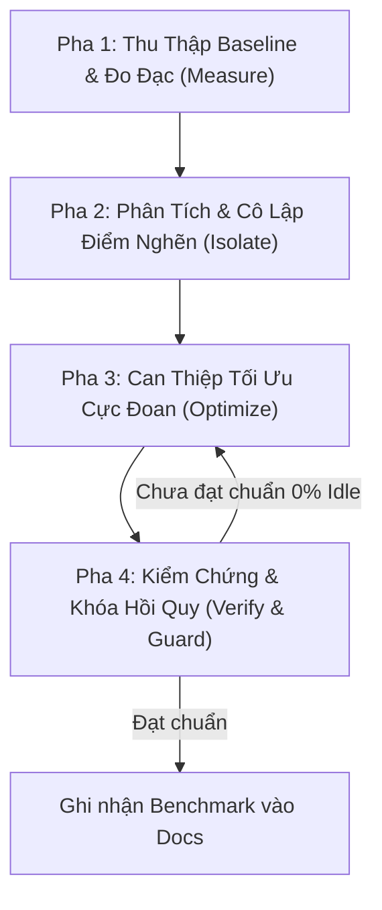

# Extreme Performance Profiling & Optimization (Đo đạc & Tối ưu hóa hiệu năng cực đoan)

## 1. Triết Lý & Nguyên Tắc Cốt Lõi (Non-Negotiable Directives)

> [!CAUTION]
> 1. **KHÔNG BAO GIỜ TỐI ƯU HÓA KHI CHƯA ĐO ĐẠC (NEVER OPTIMIZE WITHOUT A PROFILE)**:
>    Tuyệt đối cấm phỏng đoán điểm nghẽn (bottleneck). Phải thu thập số liệu cụ thể (Baseline Metrics: CPU %, Private Bytes, Working Set RAM, Frame time ms, IPC roundtrip) bằng công cụ đo đạc thực tế trước khi sửa bất kỳ dòng mã nào.
> 2. **TIÊU CHUẨN HIỆU NĂNG CỰC ĐOAN (THE ZERO-IDLE LAW)**:
>    - **Khi ứng dụng ở trạng thái tĩnh (Idle / Paused / Minimized)**: CPU phải đạt mức tiệm cận tuyệt đối **0.0% – 0.5%**, không có bất kỳ Timer nào chạy vô tận ở chu kỳ dưới 2000ms.
>    - **Khi đang phát nhạc (Playing State)**: CPU tối đa $\le$ 3–5%, RAM Working Set $\le$ 150MB trên Windows và $\le$ 80MB trên Linux.
>    - **Độ trễ phản hồi UI (Interaction Latency)**: Click-to-action $\le$ 16ms (đáp ứng 60fps/120fps không rớt khung hình).
> 3. **CHỨNG CỨ TRƯỚC KẾT LUẬN (EVIDENCE BEFORE ASSERTIONS)**:
>    Mọi nhiệm vụ tối ưu hóa bắt buộc phải có bảng đối sánh **Trước (Before) vs Sau (After)** kèm log đo lường thực tế từ `scripts/profile_process.py`, `py-spy`, hoặc `QSG_RENDER_TIMING`.

---

## 2. Quy Trình 3 Pha Chuẩn (The 3-Phase Optimization Lifecycle)



---

## 3. Bộ Công Cụ Đo Đạc & Hồ Sơ Hiệu Năng (Profiling Toolkit)

### A. Đo Đạc Tài Nguyên Hệ Thống Tự Động (CPU, RAM, Handles)
Sử dụng script tích hợp đo đạc với tần suất cao (0.5s/mẫu) trực tiếp qua Win32 Kernel/PSAPI hoặc Linux `/proc`:

```bash
# Đo đạc tiến trình theo PID trong 10 giây
python .agent/skills/extreme-performance-optimization/scripts/profile_process.py --pid <PID> --duration 10 --interval 0.5

# Hoặc tự động tìm tiến trình theo tên:
python .agent/skills/extreme-performance-optimization/scripts/profile_process.py --name "python" --duration 10
python .agent/skills/extreme-performance-optimization/scripts/profile_process.py --name "Nutsty" --duration 15
```

### B. Hồ Sơ CPU Tuyến Trình Ngoài (Out-of-Process Sampling via `py-spy`)
Không làm chậm chương trình, hỗ trợ xuất biểu đồ nhiệt Flamegraph:

```bash
# Xem trực tiếp top hàm tiêu tốn CPU theo thời gian thực
py-spy top --pid <PID>

# Ghi lại flamegraph SVG trong 10 giây (cực kỳ trực quan)
py-spy record -o cpu_flamegraph.svg --pid <PID> --duration 10 --rate 100
```

### C. Đo Đạc Scene Graph & GPU Render (Qt 6 / QML)
Kích hoạt các biến môi trường chẩn đoán đồ họa trước khi khởi chạy:

```bash
# Đo đạc chi tiết thời gian render loop (Sync, Polish, Render stages)
$env:QSG_RENDER_TIMING = "1"

# Kiểm tra hiện tượng FBO Overdraw (đổi màu theo số lớp chồng chéo)
$env:QSG_VISUALIZE = "overdraw"

# Kiểm tra hiện tượng phân mảnh Draw Calls / Batches
$env:QSG_VISUALIZE = "batches"

# Theo dõi các vùng bị vẽ lại liên tục (Dirty Rects)
$env:QSG_VISUALIZE = "changes"
```

### D. Đo Đạc Rò Rỉ Bộ Nhớ & Allocations (Python `tracemalloc`)
Tìm chính xác dòng code cấp phát ram không được giải phóng:

```python
import tracemalloc

tracemalloc.start()
# Chạy khối tác vụ cần kiểm tra
snapshot = tracemalloc.take_snapshot()
top_stats = snapshot.statistics('lineno')
for stat in top_stats[:10]:
    print(stat)
```

---

## 4. Cẩm Nang Thủ Thuật Tối Ưu Cực Đoan (Extreme Optimization Playbook)

### 1. Triệt Tiêu Vòng Lặp Polling (Eliminating Polling Loops)
- **Vấn đề**: Các `Timer { interval: 100; repeat: true }` liên tục đánh thức CPU, ngắt quãng trạng thái C-State của vi xử lý và ngốn 15–30% CPU.
- **Giải pháp cực đoan**:
  - Chuyển hoàn toàn sang kiến trúc **Event-Driven Push** (qua WebSockets, Named Pipes, hoặc Signals).
  - Áp dụng **Adaptive Dynamic Intervals (Khoảng thời gian thích ứng)**:
    ```qml
    // Tự động giãn tần suất khi tạm dừng hoặc ẩn cửa sổ
    Timer {
        id: pollTimer
        interval: (!win.visible && !win.desktopLyricsEnabled) 
            ? 3000 
            : (win.isPlaying ? 250 : (win.isLoadingAudio ? 180 : 2000))
        running: true
        repeat: true
    }
    ```

### 2. Loại Bỏ Kính Lỏng Nặng & Thay Thế Bằng Hardware Bilinear Haze
- **Vấn đề**: Áp dụng hiệu ứng `MultiEffect` với `blurMax: 48` trên diện tích 1.000.000 pixel toàn màn hình gây tiêu tốn 40% CPU nếu chạy trên card tích hợp hoặc Software OpenGL rasterizer.
- **Giải pháp cực đoan**:
  - Dùng kỹ thuật **Hardware Bilinear Downscale Haze**: Thu nhỏ hình ảnh nền về tỷ lệ siêu nhỏ (ví dụ `sourceSize: Qt.size(80, 45)`). Bộ xử lý Texture Filtering của GPU tự động làm nhòe mượt mà bằng phần cứng với chi phí **0.01ms (Zero CPU)**.
  ```qml
  Image {
      id: ambientBlurImg
      anchors.fill: parent
      source: win.currentCoverUrl
      sourceSize: Qt.size(80, 45) // Hardware Bilinear Downsampling
      fillMode: Image.PreserveAspectCrop
      smooth: true
  }
  ```

### 3. Phân Rã & Lazy-Load Hiệu Ứng Shader (Loader-Gated Shaders)
- **Vấn đề**: Khởi tạo `MultiEffect` trên hàng chục Item trong ListView/Flow làm tràn bộ nhớ VRAM và FBO Thrashing.
- **Giải pháp cực đoan**:
  - Luôn bọc `MultiEffect` bên trong `Loader`, chỉ kích hoạt `active: isSinging && isVisible` cho đúng duy nhất 1 từ hoặc 1 dòng đang hát:
  ```qml
  Loader {
      id: glowLoader
      anchors.fill: charRow
      active: wordRoot.isSinging && wordRoot.flareGate > 0.05
      visible: active
      sourceComponent: Component {
          MultiEffect {
              source: charRow
              anchors.fill: parent
              shadowEnabled: true
              shadowColor: "#ffffff"
              shadowBlur: 0.95
          }
      }
  }
  ```

### 4. Typographic Halos Thay Thế Cho Shader Glows
- **Vấn đề**: Sử dụng Gaussian Blur để tạo vầng sáng cho văn bản hát karaoke tốn tài nguyên GPU render pass.
- **Giải pháp cực đoan**:
  - Sử dụng trực tiếp Native Glyph Outline của Qt (`style: Text.Outline` + `styleColor: rgba(...)`) trên một layer chữ phóng to 1.03x đặt phía dưới: Đạt hiệu ứng Phosphor Bloom rực rỡ với **0% GPU Shader Overhead**.

### 5. Khử Khóa (Lock Contention Removal) & Tách Rời I/O
- **Vấn đề**: Giữ lock `threading.Lock()` trong khi định dạng chuỗi JSON hoặc ghi file gây Deadlock và đóng băng giao diện người dùng (GUI Thread Freeze).
- **Giải pháp cực đoan**:
  - Dùng `threading.RLock()` cho các cấu trúc trạng thái lồng nhau.
  - **Quy tắc giải phóng trước khi định dạng (Format Outside Lock)**:
    ```python
    with self._lock:
        data_snapshot = self._state.copy()
    # Serialize JSON và đẩy I/O HOÀN TOÀN NGOÀI KHỐI LOCK:
    payload = json.dumps(data_snapshot)
    self._send_payload(payload)
    ```

### 6. Tái Sử Dụng Kết Nối HTTP (Connection Pooling & Keep-Alive)
- **Vấn đề**: Gọi `requests.get()` hoặc `urllib.request` theo từng chu kỳ ngắn buộc hệ thống thực hiện TCP 3-way handshake và TLS negotiation liên tục, ngốn tài nguyên mạng và CPU.
- **Giải pháp cực đoan**:
  - Dùng một `requests.Session()` dùng chung duy nhất (Pooled HTTP Client) với Keep-Alive headers.

### 7. Di Trú Hot Paths Sang Native Rust Crates
- **Vấn đề**: Python daemon xử lý định tuyến HTTP, IPC parsing, hoặc quét thư viện chiếm 60–120MB RAM và có GIL (Global Interpreter Lock).
- **Giải pháp cực đoan**:
  - Biên dịch logic sang Rust binary (`nutsty-bridge`, `nutsty-daemon`, `nutsty-library`): Giảm RAM xuống **< 5MB** và thời gian phản hồi còn **< 0.1ms**.

---

## 5. Bảng Checklist Kiểm Tra Hiệu Năng Bắt Buộc (Mandatory Verification)

Trước khi đóng bất kỳ ticket tối ưu nào, hãy kiểm tra và xác nhận:
- [ ] Đã chạy `profile_process.py` đo lường trước và sau khi tối ưu.
- [ ] Trạng thái Paused / Idle đạt mức CPU $\le$ 0.5%.
- [ ] Không có `Timer` nào có `running: true` khi thành phần cha bị ẩn (`visible: false`).
- [ ] Các hiệu ứng Shader / `MultiEffect` nặng đều được bọc qua `Loader` với điều kiện `active`.
- [ ] Không format chuỗi hoặc ghi đĩa I/O bên trong các khối `with lock:`.
- [ ] Chạy `python scripts/verify_codebase.py` pass 100% không có lỗi AST hay hợp đồng kết nối.
